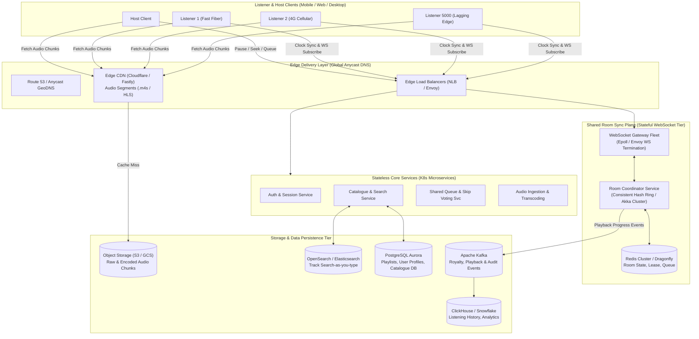
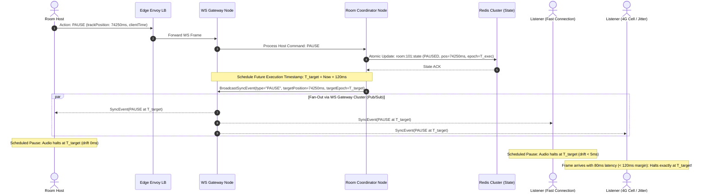

# Question 2: Music Streaming with Shared Listening Rooms ("Listen Together")
## High-Scale Backend & System Architecture Design Document

**Author:** Amit  
**Target Scale:** 20M Monthly Active Users (MAU) | 2M Peak Concurrent Listeners | 50M Track Catalogue | 200k Peak Concurrent Shared Rooms (2 to 5,000 Listeners / Room)

---

## 1. Executive Summary & Scale Estimates

### 1.1 Scale & Traffic Estimation
* **Peak Concurrent Active Listeners:** 2,000,000 users.
* **Shared Rooms at Peak:** 200,000 concurrent rooms.
* **Room Fan-Out Distribution:**
  * Median room: 3–6 listeners (Long tail, ~190,000 rooms).
  * Influencer / Celebrity / DJ rooms: Up to 5,000 listeners (~10,000 large rooms).
* **Audio Streaming Bandwidth:**
  * High-quality stream: 256 kbps AAC / Opus ($\approx 32\text{ KB/sec}$).
  * Total peak edge audio egress: $2{,}000{,}000 \times 32\text{ KB/sec} = 64\text{ GB/sec} = 512\text{ Gbps}$ (served primarily by Edge CDNs).
* **Room Sync Signal Traffic:**
  * 200,000 rooms sending heartbeats / clock sync pings every 5s:
  * Inbound sync requests: $\approx 400{,}000\text{ req/sec}$ into WebSocket Gateway clusters.
  * Fan-out on host actions (e.g. Pause/Seek in 5,000-user room): Instant push event to 5,000 connected sockets.

---

## 2. End-to-End System Architecture Diagram

---

## 3. Core Subsystem Architecture

### 3.1 Audio Delivery Subsystem
* **Audio Storage & Master Files:**
  * Masters ingested as lossless FLAC ($24\text{-bit} / 96\text{ kHz}$).
  * Stored with multi-region replication in AWS S3 / Google Cloud Storage.
* **Transcoding Matrix & Adaptive Bitrate (ABR):**
  * Transcoded asynchronously into chunked CMAF (Common Media Application Format) segments packaged as HLS and MPEG-DASH.
  * Three quality tiers:
    1. **Low (Data Saver):** 64 kbps Opus / HE-AAC v2 (ideal for unstable 3G/4G).
    2. **Medium (Standard):** 160 kbps AAC / Opus.
    3. **High (HiFi):** 320 kbps AAC / Ogg Vorbis.
  * Segment Duration: **2-second chunk segments**. Shorter segments allow rapid seeking, instant track skipping, and low buffer bloat.
* **Fast Playback Start (< 150ms start time):**
  * Byte-Range Requests: Clients request Chunk 0 (header + first 2 seconds) immediately upon queue assignment.
  * Audio pre-fetching: When current track reaches the final 10 seconds, client workers pre-fetch the initial 2 chunks of the upcoming queue track into local memory cache.
  * CDN Range Caching: Edge CDN nodes cache byte ranges 0–64KB with warm edge tiering.

---

### 3.2 Catalogue & Search Subsystem
* **Metadata Persistence:**
  * Relational metadata (Artists, Albums, Tracks, ISRC codes, Licensors) stored in **PostgreSQL Aurora** with primary-replica topology.
* **Search-as-you-type (< 30ms latency):**
  * Backed by **OpenSearch / Elasticsearch cluster**.
  * Multi-field indexing:
    * `edge_ngram` tokenizers on track title, artist name, and album name for instant prefix matching.
    * Phonetic matching (Double Metaphone) and Levenshtein fuzziness ($distance = 1$) to absorb typos.
    * Popularity boosting: Search ranking boosted by track play velocity and 30-day global stream count.
* **New Release Publishing:**
  * When a label drops a new album, metadata is written to PostgreSQL.
  * **Debezium CDC (Change Data Capture)** captures WAL logs and publishes `catalog.track.published` events to Kafka.
  * OpenSearch indexing consumers ingest the Kafka stream in near-real-time (< 500ms).
  * CDN edge purge webhook invalidates cached catalogue query responses via surrogate keys.

---

### 3.3 Room Sync Engine (< 200ms Tight Synchronization)

Keeping 5,000 independent listener devices synchronized to within 200ms across varying network topologies requires decoupling audio transport from playback timing.

#### A. Decoupled Architecture: Streaming vs. Timing
* **Audio Data:** Fetched independently by each client from local Edge CDNs.
* **Playback Timing:** Governed by an authoritative **Playback Timeline Reference** broadcast over WebSockets:
  $$\text{Timeline} = \{ \text{trackId}, \text{trackPositionMs}, \text{serverEpochTimestampMs}, \text{playbackState: PLAYING | PAUSED} \}$$

#### B. Continuous Clock Synchronization (NTP-over-WebSocket)
Each client continuously measures round-trip time ($RTT$) and clock offset against the room server using lightweight ping-pong frames:
1. Client sends ping with client send timestamp $T_1$.
2. Server responds with server receive timestamp $T_2$ and server transmit timestamp $T_3$.
3. Client receives pong at $T_4$.
$$\text{One-Way Delay (OWD)} \approx \frac{(T_4 - T_1) - (T_3 - T_2)}{2}$$
$$\text{Clock Skew} = \frac{(T_2 - T_1) + (T_3 - T_4)}{2}$$
Clients filter jitter using an exponential moving average (EMA) of skew over the last 5 samples.

#### C. Expected Playback Position Calculation
At any local instant $t_{\text{client}}$, the expected track position is:
$$\text{ExpectedPos}(t) = \text{trackPositionMs} + \left( (t_{\text{client}} + \text{ClockSkew}) - \text{serverEpochTimestampMs} \right)$$
$$\Delta = \text{ActualAudioPosition} - \text{ExpectedPos}$$

#### D. Dynamic Drift Correction (Non-Jarring Audio Smoothing)
* **If $|\Delta| \le 30\text{ ms}$:** In perfect sync. No correction.
* **If $30\text{ ms} < |\Delta| \le 200\text{ ms}$:** Micro pitch-neutral time stretching. The Web Audio API / ExoPlayer adjusts `playbackRate` to $0.96\times$ (if running ahead) or $1.04\times$ (if lagging) until $\Delta < 15\text{ ms}$. Users hear continuous music without clicks or audio drops!
* **If $|\Delta| > 200\text{ ms}$:** Hard seek. Audio jumps directly to $\text{ExpectedPos} + 150\text{ ms}$ pre-buffer.

#### E. Late Joiners
When a listener joins mid-song:
1. WebSocket delivers immediate snapshot: `{ trackId, currentPositionMs: 84200, serverTimestamp: 1776000000, queue: [...] }`.
2. Client starts downloading chunk corresponding to 84.2s ($84.2 / 2 = \text{chunk } 42$).
3. Audio engine buffers 150ms and commences playback seamlessly synchronized with the room.

---

### 3.4 Shared Queue & Skip Voting Engine
* **Queue Data Structure:** Managed in Redis using Sorted Sets (`ZSET`) keyed by `room:{id}:queue`, scored by insertion time or vote priority.
* **Vote to Skip:**
  * Skipped threshold formula: $\lceil 0.5 \times \text{activeListeners} \rceil$ (or host override).
  * Votes tracked in Redis Set `room:{id}:votes:{trackId}` with hyperloglog / bitmap.
  * When threshold reached, the room coordinator triggers an atomic `SKIP` event, transitioning all listeners to the next queue track at offset 0ms.

---

## 4. Sequence Diagram: Host Presses Pause in a Room of 5,000 Listeners

---

## 5. Data & Storage Architecture: What Goes Where and Why

| Data Domain | Storage Engine | Schema / Data Model | Architectural Justification |
| :--- | :--- | :--- | :--- |
| **Room Real-Time State** | **Redis Cluster** (or Dragonfly) | Hashes (`HSET room:id`), Sorted Sets for queues | Sub-millisecond reads/writes, atomic Lua script execution for voting, built-in TTL for idle room eviction. |
| **Track Metadata & Users** | **PostgreSQL Aurora** (Multi-AZ) | Normalized relational schema (Artists, Tracks, Albums, Users) | Strict ACID transactional consistency, rich foreign-key relationships, battle-tested indexing. |
| **Catalogue Search** | **OpenSearch Cluster** | Document-based (Track documents with n-grams & embeddings) | Sub-30ms full-text fuzzy queries, prefix match-as-you-type, multi-attribute scoring. |
| **Listening History** | **Apache Cassandra / ScyllaDB** | Wide-column time-series: `((user_id), played_at, track_id, duration)` | Massive write throughput ($> 500\text{k writes/sec}$), append-only time-ordered reads, zero single points of failure. |
| **Royalty & Stream Auditing** | **Apache Kafka + ClickHouse** | Partitioned Kafka topics -> ClickHouse columnar store | Non-lossy event sourcing. Kafka guarantees at-least-once delivery; ClickHouse performs lightning aggregations for label billing. |
| **Raw & Transcoded Audio** | **AWS S3 / GCS + Edge CDN** | Object store: `/tracks/{hash}/{bitrate}/{chunk_num}.m4s` | 99.999999999% durability, unlimited horizontal storage, low cost, native integration with CDNs. |

---

## 6. Key Decisions & Alternatives Rejected

### Decision 1: Edge CDN CMAF Chunks vs. Centralized WebRTC Audio Streaming
* **Chosen:** Edge CDN delivery of 2-second CMAF chunks + WebSocket timing sync.
* **Alternative Rejected:** Centralized WebRTC Media Server broadcasting mixed audio.
* **Why:** WebRTC media servers encoding 200,000 distinct audio streams would require tens of thousands of expensive GPU/CPU nodes, resulting in massive operational costs ($\approx \$1.5\text{M+/month}$) and brittle failover. CDN-based chunk caching leverages existing commercial edge infrastructure where 5,000 listeners download the same cached chunks for pennies, with 98%+ cache hit rates.

### Decision 2: Scheduled Execution Timestamps vs. Immediate Command Execution
* **Chosen:** Scheduled Future Execution ($T_{\text{target}} = T_{\text{server}} + 120\text{ms}$).
* **Alternative Rejected:** Immediate Execution ("Pause Right Now").
* **Why:** In immediate execution, packet delivery jitter creates a 100–300ms spread between the first listener pausing and the last listener pausing. By assigning a small 120ms future epoch target, all clients receive the packet before $T_{\text{target}}$ and execute the pause simultaneously, delivering flawless sub-20ms perceptual synchronization.

### Decision 3: Consistent Hash Ring with Virtual Nodes vs. Sticky Load Balancers for Rooms
* **Chosen:** Consistent Hash Ring (e.g. Chord / Dynamo-style ring with virtual nodes) for room coordinator ownership.
* **Alternative Rejected:** Standard sticky-cookie ALB session routing.
* **Why:** Sticky load balancer cookies only pin a client to a server; they do not aggregate multiple distinct clients in room 101 to the same coordinator process. Consistent hashing routes all 5,000 listeners of room 101 deterministically to the identical coordinator node without centralized locking bottlenecks.

---

## 7. Five Failure Scenarios and Mitigations

### Failure Scenario 1: The Node Holding a 5,000-Listener Room Dies Mid-Stream
* **Impact:** 5,000 listeners lose their active WebSocket connection.
* **Detection & Mitigation:**
  1. Room coordinator heartbeat fails (Consul / ZooKeeper ephemeral node lease expires within 2 seconds).
  2. The Consistent Hashing Ring detects node death and reassigns `room:101` to the adjacent successor node.
  3. The successor node loads the room snapshot from Redis (`room:101:state`).
  4. The 5,000 clients reconnect via exponential backoff with jitter (50ms–500ms).
  5. The new node validates the session token and resumes playback without pausing the music.

### Failure Scenario 2: Severe Transatlantic CDN Outage in One Region
* **Impact:** European listeners cannot fetch audio chunks from Primary CDN.
* **Detection & Mitigation:**
  * Multi-CDN Dynamic Switching: Client-side SDK tracks chunk fetch timeouts ($> 400\text{ms}$ or HTTP 5xx).
  * After 2 consecutive failures, client switches to Secondary CDN (e.g. Fastly -> Cloudflare) seamlessly using alternate origin URLs.

### Failure Scenario 3: Regional Cloud Outage (e.g., us-east-1 goes dark)
* **Impact:** Entire availability zone and control plane offline in one geography.
* **Detection & Mitigation:**
  * Route 53 Anycast GeoDNS health checks fail within 10 seconds.
  * Traffic automatically reroutes to `eu-west-1` or `us-west-2`.
  * Redis Global Active-Active replication (Redis Enterprise CRDTs / AWS Aurora Global Database) ensures room states and catalogue queries are available globally with $< 1\text{s}$ replication lag.

### Failure Scenario 4: Rolling Deployment / Software Upgrade Without Dropping Live Rooms
* **Impact:** Upgrading WebSocket Gateway software could terminate 2M socket connections simultaneously.
* **Detection & Mitigation:**
  * **Connection Draining (Graceful Degradation):**
    1. New pods are deployed alongside old pods.
    2. Old pods stop accepting new rooms and set `Connection: close` on heartbeats.
    3. Old pods send a gentle `MIGRATE_RECONNECT` hint with a random 0–30s delay spread.
    4. Client connects to the new pod in the background before closing the old socket ("make-before-break"). Live rooms experience zero dropped frames.

### Failure Scenario 5: High-Jitter Cell Tower Congestion for an Individual Listener
* **Impact:** Client experiences frequent packet loss; audio playback stalls and falls out of sync.
* **Detection & Mitigation:**
  * **Dynamic Degradation Ladder:**
    1. Client detects buffer underrun ($< 1\text{s}$ buffer remaining).
    2. SDK immediately steps down audio quality (160 kbps -> 64 kbps Opus).
    3. If lag exceeds 500ms, client mutes audio, pre-buffers 2 seconds of the low-bitrate stream, and executes an audio catch-up seek directly into the current room playback position.

---

## 8. Observability: Metrics That Prove Sync Is Working

To verify whether listeners are truly hearing the same beat at the same instant, we monitor four critical Service Level Indicators (SLIs):

1. **Client Audio Drift Percentiles ($p_{50}, p_{95}, p_{99}$):**
   * Measured via client-side telemetry: $\Delta = |\text{ActualPlayhead} - \text{ExpectedPlayhead}|$.
   * **SLO Target:** $p_{95} \le 120\text{ ms}$, $p_{99} \le 200\text{ ms}$.
2. **Clock Skew Uncertainty ($\sigma_{\text{skew}}$):**
   * Standard deviation of round-trip NTP ping calculations. Alerts if network jitter exceeds 50ms.
3. **Rebuffer Ratio (% of listening time spent stalled):**
   * **SLO Target:** $< 0.15\%$ across all global sessions.
4. **Action Convergence Latency ($T_{\text{action\_complete}} - T_{\text{host\_click}}$):**
   * The duration from when the host taps "Pause" or "Seek" to when $99\%$ of listeners acknowledge execution.
   * **SLO Target:** $< 350\text{ ms}$ worldwide.

---

## 9. Engineering Roadmap: 3-Person Team Execution

If tasked with launching this product with a lean team of 3 engineers over 3 months:

### Phase 1: Build First (MVP - Months 1 to 2)
1. **Engineer 1 (Audio & CDN Pipeline):**
   * S3 bucket storage + Cloudflare CDN configuration.
   * Basic ffmpeg transcoding worker converting MP3s to 2-second HLS/AAC chunks.
   * Web Audio API player with byte-range buffering.
2. **Engineer 2 (Sync Engine & WebSocket Hub):**
   * Node.js / Go WebSocket server with Redis state store.
   * Room create/join shareable link handler.
   * NTP clock sync ping-pong and host Pause/Play broadcast.
3. **Engineer 3 (Shared Queue & Client Integration):**
   * Redis-backed shared queue with add-to-queue and vote-to-skip.
   * Client-side drift correction using `playbackRate` fine-tuning.
   * Basic search endpoint with PostgreSQL text search.

### Phase 2: Postpone to Post-Launch / Phase 2
* **Postponed Features:**
  * Multi-region active-active database failover (start single-region multi-AZ).
  * OpenSearch phonetics & typo tolerance (start with Postgres `pg_trgm` / trigram search).
  * Cassandra / ClickHouse royalty streaming pipeline (log to S3 json files and process batch nightly).
  * Video synchronization or lyrics timecode alignment.
  * Dynamic room sharding for 5,000+ listener mega-stadium rooms (cap rooms at 50 listeners for v1).
